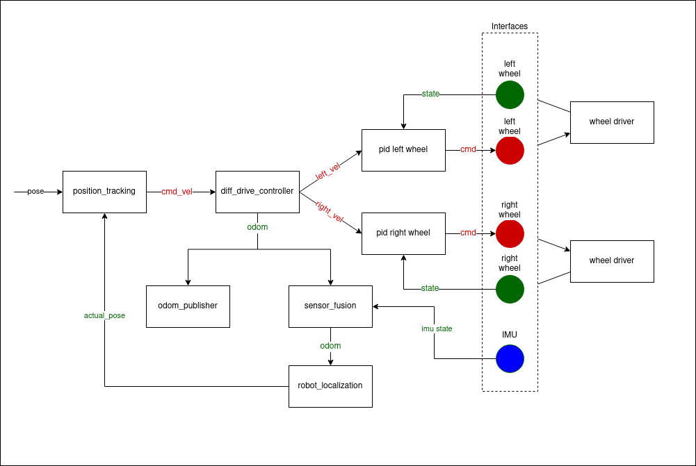

:github_url: https://github.com/ros-controls/ros2_control/blob/{REPOS_FILE_BRANCH}/controller_manager/doc/controller_chaining.rst

.. _controller_chaining:

Controller 串联 / 级联控制
======================================

本文档就串联 controller 链提出最小可行实现，如 `Chaining Controllers design document <https://github.com/ros-controls/roadmap/blob/master/design_drafts/controller_chaining.md>`__ 所述。
级联控制（cascade control）是 controller 串联的一种特定类型。

文档范围与背景知识
-------------------------------------------------------

本方案仅关注 controller 的串行串联，并尽量复用既有机制。
它聚焦于 `controller 的输入与输出 <https://github.com/ros-controls/roadmap/blob/master/design_drafts/controller_chaining.md#input--outputs-of-a-controller>`__ 以及在 controller manager 中的管理。
为便于理解，将引入 `controller group <https://github.com/ros-controls/roadmap/blob/master/design_drafts/controller_chaining.md#controller-group>`__ 概念，其唯一含义是：该 group 内的 controller 可按任意顺序 update。
这并不表示 `controller 串联文档 <https://github.com/ros-controls/roadmap/blob/master/design_drafts/controller_chaining.md#controller-group>`__ 中描述的 controller group 将来不会引入并使用。
尽管如此，作者认为在当前阶段只会增加不必要的复杂度，尽管从长远看它们*有可能*提供更清晰的结构与 interface。

动机、目的与用途
---------------------------------

为说明本文档的意图，关注一个简单但足够充分的示例：`controllers_chaining` 设计文档中的 `Example 2 <https://github.com/ros-controls/roadmap/blob/master/design_drafts/controller_chaining.md#example-2>`__：

在此示例中，我们希望将 ``position_tracking`` controller 与 ``diff_drive_controller``、两个 PID controller 以及 ``robot_localization`` controller 串联。
设想一种用例：我们不仅希望将上述 controller 作为一组运行，还要能灵活地添加前置步骤。
这意味着：

  1. 机器人启动时，需要检查电机速度控制是否正常工作，因此仅激活 PID controller。
     此阶段也可通过 topic 在外部控制 PID controller 的输入。
     但这些 controller 也提供 virtual interface，因而可以串联。
  2. 随后激活 ``diff_drive_controller``，并连接到 PID controller 的 virtual 输入 interface。
     PID controller 同时会被告知处于串联（chained）模式，从而通过 subscriber 禁用其外部 interface。
     此时可检查差速机器人的运动学是否正常。
  3. 一旦 ``diff_drive_controller`` 激活，它会暴露 ``odom`` state interface，供 ``odom_publisher`` 与 ``sensor_fusion`` controller 使用。
     激活 ``odom_publisher`` controller 并连接到 ``diff_drive_controller`` 导出的 ``odom`` state interface。
     激活 ``sensor_fusion`` controller 并连接到 ``diff_drive_controller`` 导出的 ``odom`` state interface，以及 ``imu`` state interface。
  4. 一旦 ``sensor_fusion`` controller 激活，它会暴露 ``odom`` state interface，供 ``robot_localization`` controller 使用。
     激活 ``robot_localization`` controller 并连接到 ``sensor_fusion`` controller 的 ``odom`` state interface。
     激活后，``robot_localization`` controller 暴露 ``actual_pose`` state interface，供 ``position_tracking`` controller 使用。
  5. 之后可激活 ``position_tracking`` 并连接到 ``diff_drive_controller``（后者禁用其外部 interface），以及提供 ``actual_pose`` state interface 的 ``robot_localization`` controller。
  6. 若任一 controller 被停用，其所有前置 controller 也需一并停用。

.. note::

  仅当其他 controller 使用其 reference interface 时，暴露 reference interface 的 controller 才会切换到 chained 模式。当 reference interface 未被其他 controller 使用时，会切换回通过 subscriber 获取 reference。
  但当其他 controller 使用其 state interface 时，暴露 state interface 的 controller 不会因此被触发进入 chained 模式。

.. note::

  本文档使用 *preceding*（前置）与 *following*（后续）controller 等术语。这些术语指如下排序：若 controller A claim（将其输出连接到）controller B 的 reference interface（输入），则 A *precedes* B。本节开头示例图中，``diff_drive_controller`` *precedes* ``pid left wheel`` 与 ``pid right wheel``。因而 ``pid left wheel`` 与 ``pid right wheel`` 是位于 ``diff_drive_controller`` *之后* 的 *following* controller。

实现
--------------

Controller 基类：ChainableController
^^^^^^^^^^^^^^^^^^^^^^^^^^^^^^^^^^^^^^^^^^^^^^^^^^^^^^^^

``ChainableController`` 在 ``ControllerInterface`` 类之上扩展了 ``virtual std::vector<hardware_interface::CommandInterface::SharedPtr> on_export_reference_interfaces_list() = 0`` 方法，以及 ``virtual std::vector<hardware_interface::StateInterface::SharedPtr> on_export_state_interfaces_list()`` 方法。
``on_export_reference_interfaces_list()`` 须由每个**可被其他 controller 前置**的 controller 实现，导出其全部 reference interface；``on_export_state_interfaces_list()`` 为可选，仅当 controller 导出 state interface 时需要重写。
为简化起见，目前假定某个 controller 的全部 reference interface 均被其他 controller 使用。但 controller 导出的 state interface 可同时被多个 controller 以任意组合方式使用。
因此不要尝试实现 reference interface 的互斥组合，若需要互斥性应编写多个 controller。

``ChainableController`` 基类实现 ``void set_chained_mode(bool activate)``，设置表示 controller 被另一 controller 使用（处于 chained 模式）的内部标志，并调用 ``virtual void on_set_chained_mode(bool activate) = 0``，在 chained 模式激活或停用时执行 controller 特有操作，例如停用 subscriber。

例如，PID controller 导出一个 virtual interface ``pid_reference``，在 chained 模式下停止其 subscriber ``<controller_name>/pid_reference``。``diff_drive_controller`` 导出 virtual interface 列表 ``<controller_name>/v_x``、``<controller_name>/v_y`` 与 ``<controller_name>/w_z``，并停止来自 topic ``<controller_name>/cmd_vel`` 与 ``<controller_name>/cmd_vel_unstamped`` 的 subscriber。其 publisher 可继续运行。

术语
^^^^^^^^^^^^^^

在 ``ros2_control`` 语境下有两类 interface：``CommandInterface`` 与 ``StateInterface``。

- ``CommandInterface`` 为可读写的 interface，用于获取与设置数值。典型用途是向 hardware 设置 command。
- ``StateInterface`` 为只读 interface，用于获取数值。典型用途是从 hardware 读取实际 state。

这些 interface 在 controller 内不同位置使用，以构成可正常工作的 controller 或向 hardware 发出 command 的 controller 链。

- ``ControllerInterface`` 类中定义的 ``virtual InterfaceConfiguration command_interface_configuration() const`` 方法用于定义 controller 使用的 command interface。这些 interface 用于向 hardware 或另一 controller 暴露的 reference interface 发出 command。``controller_manager`` 据此配置从 ``ResourceManager`` claim command interface。
- ``ControllerInterface`` 类中定义的 ``virtual InterfaceConfiguration state_interface_configuration() const`` 方法用于定义 controller 使用的 state interface。这些 interface 用于从 hardware 或另一 controller 暴露的 state interface 获取实际 state。``controller_manager`` 据此配置从 ``ResourceManager`` claim state interface。
- ``ChainableController`` 类中定义的 ``std::vector<hardware_interface::CommandInterface::SharedPtr> on_export_reference_interfaces_list()`` 方法用于定义 controller 暴露的 reference interface。其他 controller 通过这些 interface 向该 controller 发出 command。
- ``ChainableController`` 类中定义的 ``std::vector<hardware_interface::StateInterface::SharedPtr> on_export_state_interfaces_list()`` 方法用于定义 controller 暴露的 state interface。其他 controller 通过这些 interface 从该 controller 获取实际 state。

内部资源管理
^^^^^^^^^^^^^^^^^^^^^^^^^^^^

在配置 chainable controller 之后，controller manager 调用 ``export_reference_interfaces`` 与 ``export_state_interfaces`` 方法，并取得 controller 导出的 reference/state interface 的所有权。
该过程与 ``ResourceManager`` 及 hardware interface 相同。
controller manager 在向量中维护 interface 的 “claimed” 状态（与 ``ResourceManager`` 中的做法相同）。

串联 Controller 的激活与停用
^^^^^^^^^^^^^^^^^^^^^^^^^^^^^^^^^^^^^^^^^^^^^^^^^^^^^^^^

串联的 controller 必须一起激活，或按正确顺序激活。
这意味着必须先激活所有 *following* controller，才能激活 *preceding* controller。
停用时规则相反——必须先停用所有 *preceding* controller，才能停用 *following* controller。
也可将其想象为一条实际的链：不能在中间添加链节或断开链条。
串联 controller 也可在 ``switch_controllers`` service 的 ``activate_controllers`` 或 ``deactivate_controllers`` 字段中以单一列表形式解析后一并激活。
controller_manager 的 ``spawner`` 也可通过传入 ``--activate-as-group`` 参数，在一次调用中激活链上全部 controller。

调试输出
----------------------------

- 当导出 reference interface 的 controller 处于 inactive 状态时，reference interface 为 ``unavailable`` 与 ``unclaimed``
- 当导出 reference interface 的 controller 处于 active 状态但未与任何其他 controller 处于 chained 模式时（controller 通过 subscriber 获取 reference），reference interface 为 ``available`` 与 ``unclaimed``
- 当导出 reference interface 的 controller 处于 active 状态且与其他 controller 处于 chained 模式时（controller 从与其串联的 controller 获取 reference），reference interface 为 ``available`` 与 ``claimed``

结束语
----------------------------

- 或许不必新增 controller 类型 ``ChainableController``。也可在 ``ControllerInterface`` 类中加入 ``export_reference_interfaces()`` 与 ``export_state_interfaces()`` 方法的实现，默认返回 ``interface_configuration_type::NONE``。