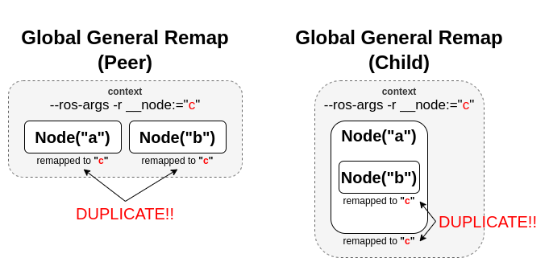
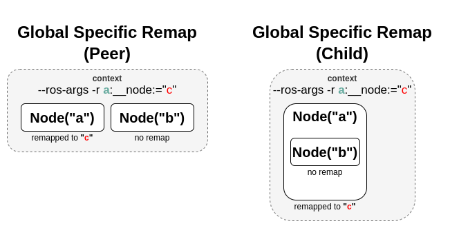
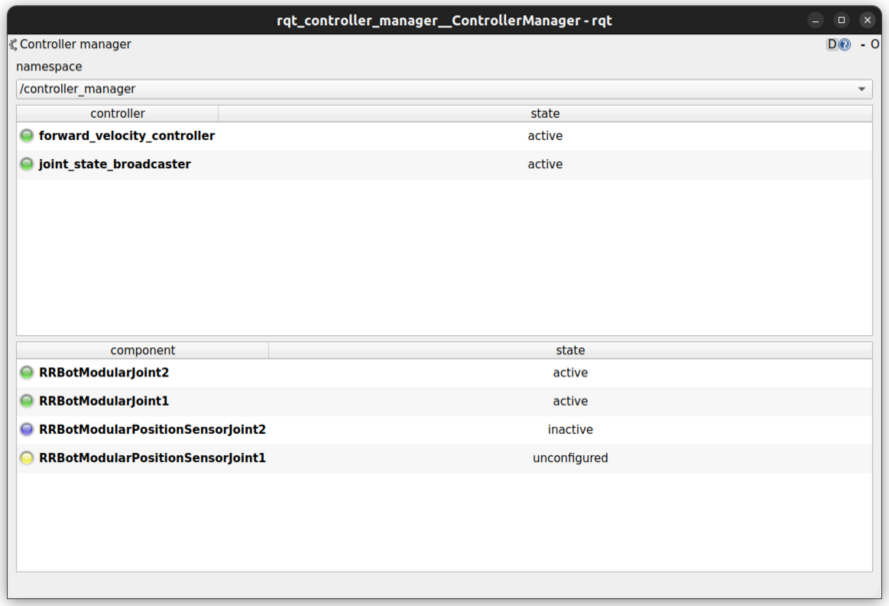

:github_url: https://github.com/ros-controls/ros2_control/blob/{REPOS_FILE_BRANCH}/controller_manager/doc/userdoc.rst

.. _controller_manager_userdoc:

Controller Manager
==================
Controller Manager 是 ros2_control 框架中的主要组件。
它管理 controller 的 Lifecycle、对 hardware interface 的访问，并向 ROS 生态提供 service。

ROS Interface
-------------

Publishers
^^^^^^^^^^

~/activity [controller_manager_msgs::msg::ControllerManagerActivity]
  每当 controller manager 所管理的 controller 或 hardware component 发生状态变更时发布的 topic。
  消息包含 controller manager 管理的 controller 与 hardware component 列表及其 Lifecycle 状态。
  该 topic 使用 “transient local” 服务质量发布，因此 subscriber 也应使用 “transient local”。

Subscribers
^^^^^^^^^^^

robot_description [std_msgs::msg::String]
  包含 URDF xml 的字符串，例如来自 ``robot_state_publisher``。
  目前尚不支持重新加载 URDF。
  ``<ros2_control>`` 标签中定义的所有 joint 均须出现在 URDF 中。

Parameters
^^^^^^^^^^

<controller_name>.type
  通过 ``pluginlib`` 导出的 controller plugin 名称。
  据此类创建名为 “``controller_name``” 的 controller 实例。

<controller_name>.params_file
  存放 controller parameter 的 YAML 文件的绝对路径。
  文件须以标准 ROS 2 YAML 格式包含该 controller 的 parameter。

<controller_name>.fallback_controllers
  当已 spawn 的 controller 在 ``update`` 周期返回 ``return_type::ERROR`` 导致失败时，作为 fallback 策略被激活的 controller 列表。
  建议将 fallback 策略所需的全部 controller 加入列表，包括主 fallback controller 所使用的 chainable controller。

.. warning::
  fallback controller 的激活取决于激活时刻 state 与 command interface 是否可用。
  建议在真实机器人上部署前于仿真中测试 fallback 策略。

.. generate_parameter_library_details::
  ../src/controller_manager_parameters.yaml
  parameters_context.yaml

**parameter 文件示例：**

.. generate_parameter_library_default::
  ../src/controller_manager_parameters.yaml

确定性
-----------

为在控制 hardware 时获得最佳性能，应尽可能减少 Controller Manager 主控制循环中的抖动。

无论安装何种内核，Controller Manager 主线程都会尝试将
``SCHED_FIFO`` 配置为优先级 ``50``。调度策略详见
`例如此处 <https://blogs.oracle.com/linux/post/task-priority>`__。

对于 realtime 任务，优先级范围为 0 到 99，数值越大优先级越高。默认情况下，用户无权设置如此高的优先级。
若要授予用户相应权限，请创建名为 realtime 的组，并将控制机器人的用户加入该组：

.. code-block:: console

    $ sudo addgroup realtime
    $ sudo usermod -a -G realtime $(whoami)

随后，在 ``/etc/security/limits.conf`` 中为 realtime 组添加以下限制：

.. code-block:: console

    @realtime soft rtprio 99
    @realtime soft memlock unlimited
    @realtime hard rtprio 99
    @realtime hard memlock unlimited

限制将在注销并重新登录后生效。

也可在 Docker 容器中以满足 realtime 要求的方式运行 ros2_control。传入以下 capability 选项，使容器能够设置线程优先级并锁定内存，例如：

.. code-block:: console

    $ docker run -it \
        --cap-add=sys_nice \
        --ulimit rtprio=99 \
        --ulimit memlock=-1 \
        --rm --net host <IMAGE>

更多信息请参阅 Docker engine 文档中的 `resource_constraints <https://docs.docker.com/engine/containers/resource_constraints/#configure-the-real-time-scheduler>`__ 与 `linux capabilities <https://docs.docker.com/engine/containers/run/#runtime-privilege-and-linux-capabilities>`__。

常规 Linux 内核针对计算吞吐量优化，因此不太适合 hardware 控制。
标准内核的替代方案包括

- Ubuntu 上的 `Real-time Ubuntu <https://ubuntu.com/real-time>`_
- Raspberry Pi 上 Ubuntu 的 `linux-raspi-realtime <https://packages.ubuntu.com/resolute/linux-raspi-realtime>`_：``sudo apt install linux-raspi-realtime``
- Debian 64 位 PC 上的 `linux-image-rt-amd64 <https://packages.debian.org/search?searchon=names&keywords=linux-image-rt-amd64>`__ 或 `linux-image-rt-arm64 <https://packages.debian.org/search?suite=default&section=all&arch=any&searchon=names&keywords=linux-image-rt-arm64>`__
- 任意 Ubuntu 上的 `lowlatency kernel <https://ubuntu.com/blog/industrial-embedded-systems>`__（``sudo apt install linux-lowlatency``）

尽管安装 realtime 内核无疑能最大程度降低抖动，但 lowlatency 内核安装简单，也能显著改善表现。

.. note::
  避免在 controller 与 hardware component 的 realtime 控制循环中使用 ``get_lifecycle_state()`` 方法，因为它并非 realtime 安全。

影响确定性的因素
^^^^^^^^^^^^^^^^^^^^^^^^^^^^^^^

在上述条件下运行时，确定性可保证至 hardware 与 realtime 内核所限。但某些情况仍会影响确定性：

* 当 controller 在 realtime 循环中激活失败时，controller_manager 将调用 ``prepare_command_mode_switch`` 与 ``perform_command_mode_switch`` 以停止已启动的 interface。这些调用可能导致主控制循环抖动。
* 若 controller 在 realtime 循环中未能完成成功的 update 周期（例如返回 ``return_type::ERROR``），controller manager 将停用该 controller（或其所属的整条 controller 链）。随后调用 ``prepare_command_mode_switch`` 与 ``perform_command_mode_switch`` 以停止受影响 controller 使用的 interface。这些操作可能给主控制循环引入抖动。

启动 controller_manager
----------------------------

使用 ros2_control_node
^^^^^^^^^^^^^^^^^^^^^^^

可使用 ros2_control_node 可执行文件启动 controller_manager。以下示例展示如何用 ros2_control_node 启动 controller_manager：

.. code-block:: python

    control_node = Node(
        package="controller_manager",
        executable="ros2_control_node",
        parameters=[robot_controllers],
        output="both",
    )

ros2_control_node 可执行文件使用 ``controller_manager`` node 的以下 parameter：

lock_memory (optional; bool; default: false for a non-realtime kernel, true for a realtime kernel)
  在启动时将 ``controller_manager`` node 的内存锁定到物理 RAM，以避免缺页错误
  并防止 node 被交换到磁盘。
  有关内存锁定设置的更多信息见： `How to set ulimit values <https://access.redhat.com/solutions/61334>`_
  可使用以下命令临时设置内存锁定限制：``ulimit -l unlimited``.

cpu_affinity (optional; int (or) int_array;)
  将 ``controller_manager`` node 的 CPU 亲和性设置为指定 CPU 核心。
  若为整数，则将 node 亲和性设置为该 CPU 核心。
  若为整数数组，则将 node 亲和性设置为指定的 CPU 核心集合。

thread_priority (optional; int; default: 50)
  将 ``controller_manager`` node 的线程优先级设置为指定值。取值须在 0 到 99 之间。

use_sim_time (optional; bool; default: false)
  在 ``controller_manager`` node 中启用仿真时间。

overruns.manage (optional; bool; default: true)
  启用或禁用 ``controller_manager`` node 的 realtime 循环中的 overrun 处理。
  若为 true，controller manager 将检测由系统时间变更或 controller 与 hardware component 执行时间过长导致的 overrun。
  若检测到 overrun，controller manager 将向控制台打印警告消息。
  当 ``use_sim_time`` 设为 true 时，忽略该 parameter，并禁用 overrun 处理。

hardware_synchronization.expect_blocking_read_write (optional; bool; default: false)
  若为 true，controller manager 不会主动 sleep。在存在会在 ``read`` 或 ``write`` 操作中阻塞、
  直至从 hardware 收到新数据的 hardware interface 时使用。

hardware_synchronization.minimum_cycle_time (optional; double; default: 0.0001)
  控制 node 的 realtime 循环的最小 sleep 时间（秒）。用于
  防止控制 node 运行过快；若 hardware 在 read / write 中不阻塞，过快运行会导致 CPU 占用过高。
  仅在 ``expect_blocking_read_write`` 为 true 时使用。
  若周期短于该值，将 sleep 该时长并打印警告。

处理多个 Controller Manager（单个/多个）
^^^^^^^^^^^^^^^^^^^^^^^^^^^^^^^^^^^^^^^^^^^^^^^^^^^^^^^

处理多个 controller manager 时，管理不同机器人描述有两种方式：

1. **使用 namespace：** 可将 ``robot_state_publisher`` 与 ``controller_manager`` node 置于同一 namespace。

.. code-block:: python

   control_node = Node(
       package="controller_manager",
       executable="ros2_control_node",
       parameters=[robot_controllers],
       output="both",
       namespace="rrbot",
   )
   robot_state_pub_node = Node(
       package="robot_state_publisher",
       executable="robot_state_publisher",
       output="both",
       parameters=[robot_description],
       namespace="rrbot",
   )

2. **使用 remapping：** 可通过 remapping 处理不同的机器人描述。使用 ``remappings`` 标签中继 topic，为每个 controller manager 指定自定义 topic。

.. code-block:: python

   control_node = Node(
       package="controller_manager",
       executable="ros2_control_node",
       parameters=[robot_controllers],
       output="both",
       remappings=[('robot_description', '/rrbot/robot_description')]
   )
   robot_state_pub_node = Node(
       package="robot_state_publisher",
       executable="robot_state_publisher",
       output="both",
       parameters=[robot_description],
       namespace="rrbot",
   )

在进程内使用 Controller Manager
^^^^^^^^^^^^^^^^^^^^^^^^^^^^^^^^^^^^^^^^^

``ControllerManager`` 也可在进程中以类实例化，但须谨慎处理。
原因在于 ``ControllerManager`` 类继承自 ``rclcpp::Node``。

若进程中存在多个 Node，全局 node 名称 remap 规则可能强制更改 ``ControllerManager`` 的 node 名称，导致 node 名称重复。
无论 Node 为同级还是层级关系，均可能发生。

变通方法是在传给 ``ControllerManager`` node 的 ``NodeOptions`` 中指定另一条 node 名称 remap 规则（使其忽略全局规则），或确保 remap 规则仅针对特定 node。

..
  TODO: (methylDragon) Update the proposed solution when https://github.com/ros2/ros2/issues/1377 is resolved

.. code-block:: cpp

    auto options = controller_manager::get_cm_node_options();
    options.arguments({
      "--ros-args",
      "--remap", "_target_node_name:__node:=dst_node_name",
      "--log-level", "info"});

    auto cm = std::make_shared<controller_manager::ControllerManager>(
      executor, "_target_node_name", "some_optional_namespace", options);

辅助脚本
--------------
有两个脚本可从 launch 文件与 controller manager 交互：

  1. ``spawner`` - 在启动时 load、configure 并 start controller。
  2. ``unspawner`` - 停止并 unload controller。
  3. ``hardware_spawner`` - 激活并 configure hardware component。

``spawner``
^^^^^^^^^^^

.. code-block:: console

    $ ros2 run controller_manager spawner -h
    usage: spawner [-h] [-c CONTROLLER_MANAGER] [-p PARAM_FILE] [--load-only] [--inactive] [--reconfigure] [-u] [--controller-manager-timeout CONTROLLER_MANAGER_TIMEOUT] [--switch-timeout SWITCH_TIMEOUT] [--service-call-timeout SERVICE_CALL_TIMEOUT] [--activate-as-group] [--switch-asap | --no-switch-asap] [--controller-ros-args CONTROLLER_ROS_ARGS] controller_names [controller_names ...]

    positional arguments:
      controller_names      List of controllers

    options:
      -h, --help            show this help message and exit
      -c CONTROLLER_MANAGER, --controller-manager CONTROLLER_MANAGER
                            Name of the controller manager ROS node
      -p PARAM_FILE, --param-file PARAM_FILE
                            Controller param file to be loaded into controller node before configure. Pass multiple times to load different files for different controllers or to override the parameters of the same controller.
      --load-only           Only load the controller and leave unconfigured.
      --inactive            Load and configure the controller, however do not activate them
      --reconfigure         Cleanup and configure the controller again
      -u, --unload-on-kill  Wait until this application is interrupted (SIGINT or SIGTERM) and deactivate/unload controllers
      --controller-manager-timeout CONTROLLER_MANAGER_TIMEOUT
                            Time to wait for the controller manager service to be available
      --switch-timeout SWITCH_TIMEOUT
                            Time to wait for a successful state switch of controllers. Useful when switching cannot be performed immediately, e.g., paused simulations at startup
      --service-call-timeout SERVICE_CALL_TIMEOUT
                            Time to wait for the service response from the controller manager
      --activate-as-group   Activates all the parsed controllers list together instead of one by one. Useful for activating all chainable controllers altogether
      --switch-asap, --no-switch-asap
                            Option to switch the controllers in the realtime loop at the earliest possible time or in the non-realtime loop.
      --controller-ros-args CONTROLLER_ROS_ARGS
                            The --ros-args to be passed to the controller node, e.g., for remapping topics. Pass multiple times for every argument.

    When launching ``spawner`` with ROS parameter files that use substitutions (for example, launch ``allow_substs=True``),
    the resolved ``--params-file`` path(s) used by the spawner node are automatically forwarded to each controller along
    with any explicit ``--param-file`` arguments passed to the spawner command.

.. note::
  若单个 parameter 文件用于多个 controller，spawner 会自动将解析后的路径转发给每个 controller。推荐以下方式：

  .. code-block:: console

    Node(
        package="controller_manager",
        executable="spawner",
        arguments=[
            "my_controller",
            "--param-file",
            PathSubstitution(FindPackageShare("my_config_pkg"))
            / "config"
            / "controllers.yaml",
        ],
    ),

  (或)

  .. code-block:: console

    Node(
        package="controller_manager",
        executable="spawner",
        parameters=[
            ParameterFile(
                PathSubstitution(FindPackageShare("my_config_pkg"))
                / "config"
                / "controllers.yaml",
            ),
        ],
        arguments=[
            "my_controller"
        ],
    ),

``spawner`` 现支持使用 ``--controller`` 选项为多个 controller 分别解析参数。例如，要 spawn 两个使用不同 parameter 文件并 remap topic 的 controller，可使用：

.. code-block:: console

    $ ros2 run controller_manager spawner --controller position_trajectory_controller \
        --param-file /path/to/position_trajectory_controller_params.yaml \
        --controller-ros-args "--ros-args --remap /joint_states:=/rrbot/joint_states" \
        --controller velocity_trajectory_controller \
        --param-file /path/to/velocity_trajectory_controller_params.yaml \
        --controller-ros-args "--ros-args --remap /joint_states:=/rrbot/joint_states"

.. code-block:: console

    $ ros2 run  controller_manager spawner --controller -h
    Usage: spawner [global_options] --controller <name> [controller_options] --controller <name> ...

    Global Options:
    usage: spawner [-c CONTROLLER_MANAGER] [--controller-manager-timeout CONTROLLER_MANAGER_TIMEOUT] [--switch-timeout SWITCH_TIMEOUT] [--service-call-timeout SERVICE_CALL_TIMEOUT] [--activate-as-group] [--switch-asap | --no-switch-asap] [-u] [-h]

    options:
      -c CONTROLLER_MANAGER, --controller-manager CONTROLLER_MANAGER
                            Name of the controller manager
      --controller-manager-timeout CONTROLLER_MANAGER_TIMEOUT
                            Timeout for controller manager services
      --switch-timeout SWITCH_TIMEOUT
                            Timeout for switch controller service
      --service-call-timeout SERVICE_CALL_TIMEOUT
                            Timeout for service calls
      --activate-as-group   Activate controllers as a group
      --switch-asap, --no-switch-asap
                            Switch controllers as soon as possible
      -u, --unload-on-kill  Deactivate the active controllers and unload them on SIGINT or SIGTERM
      -h, --help            Show help

    Controller Options:
    usage: spawner [-p PARAM_FILE] [--load-only] [--inactive] [--reconfigure] [--controller-ros-args CONTROLLER_ROS_ARGS] controller_name

    positional arguments:
      controller_name       Name of the controller

    options:
      -p PARAM_FILE, --param-file PARAM_FILE
                            Parameter files to load for the controller
      --load-only           Load the controller but do not configure/activate it
      --inactive            Configure the controller but do not switch it
      --reconfigure         Cleanup and configure the controller again
      --controller-ros-args CONTROLLER_ROS_ARGS
                            ROS arguments to pass to the controller

解析后的 controller 配置文件可遵循与典型 ROS 2 parameter 文件相同的约定。spawner 现可处理含通配条目的配置文件，以及绝对 namespace 中的 controller 名称。配置文件示例见下：

 .. code-block:: yaml

    /**:
      ros__parameters:
        type: joint_trajectory_controller/JointTrajectoryController

        command_interfaces:
          - position
          .....

    position_trajectory_controller_joint1:
      ros__parameters:
        joints:
          - joint1

    position_trajectory_controller_joint2:
      ros__parameters:
        joints:
          - joint2

 .. code-block:: yaml

    /**/position_trajectory_controller:
      ros__parameters:
        type: joint_trajectory_controller/JointTrajectoryController
        joints:
          - joint1
          - joint2

        command_interfaces:
          - position
          .....

 .. code-block:: yaml

    /position_trajectory_controller:
      ros__parameters:
        type: joint_trajectory_controller/JointTrajectoryController
        joints:
          - joint1
          - joint2

        command_interfaces:
          - position
          .....

 .. code-block:: yaml

    position_trajectory_controller:
      ros__parameters:
        type: joint_trajectory_controller/JointTrajectoryController
        joints:
          - joint1
          - joint2

        command_interfaces:
          - position
          .....

 .. code-block:: yaml

    /rrbot_1/position_trajectory_controller:
      ros__parameters:
        type: joint_trajectory_controller/JointTrajectoryController
        joints:
          - joint1
          - joint2

        command_interfaces:
          - position
          .....

namespace 也可拆分到嵌套键中，可带或不带前导斜杠（``/rrbot_1:`` 或 ``rrbot_1:``）：

 .. code-block:: yaml

    /rrbot_1:
      position_trajectory_controller:
        ros__parameters:
          type: joint_trajectory_controller/JointTrajectoryController
          .....

条目与 controller 的完全限定名称匹配，规则与 ``rclcpp`` 相同：``/*`` 匹配一个 namespace 令牌，``/**`` 在名称任意位置匹配任意多个（例如 ``/*/position_trajectory_controller`` 或 ``/rrbot_1/**/position_trajectory_controller``）。当多条目匹配时，按文件顺序应用，后加载的文件覆盖先前的，故以最后匹配为准，与运行时一致。

``unspawner``
^^^^^^^^^^^^^

.. code-block:: console

    $ ros2 run controller_manager unspawner -h
    usage: unspawner [-h] [-c CONTROLLER_MANAGER] [--switch-timeout SWITCH_TIMEOUT] controller_names [controller_names ...]

    positional arguments:
      controller_names      Name of the controller

    options:
      -h, --help            show this help message and exit
      -c CONTROLLER_MANAGER, --controller-manager CONTROLLER_MANAGER
                            Name of the controller manager ROS node
      --switch-timeout SWITCH_TIMEOUT
                            Time to wait for a successful state switch of controllers. Useful if controllers cannot be switched immediately, e.g., paused
                            simulations at startup

``hardware_spawner``
^^^^^^^^^^^^^^^^^^^^

.. code-block:: console

    $ ros2 run controller_manager hardware_spawner -h
    usage: hardware_spawner [-h] [-c CONTROLLER_MANAGER] [--controller-manager-timeout CONTROLLER_MANAGER_TIMEOUT] (--activate | --configure) hardware_component_names [hardware_component_names ...]

    positional arguments:
      hardware_component_names
                            The name of the hardware components which should be activated.

    options:
      -h, --help            show this help message and exit
      -c CONTROLLER_MANAGER, --controller-manager CONTROLLER_MANAGER
                            Name of the controller manager ROS node
      --controller-manager-timeout CONTROLLER_MANAGER_TIMEOUT
                            Time to wait for the controller manager
      --activate            Activates the given components. Note: Components are by default configured before activated.
      --configure           Configures the given components.

颜色输出处理
^^^^^^^^^^^^^^^^^^^^^

辅助脚本（``spawner`` 与 ``hardware_spawner``）现使用感知环境的 ``bcolors`` 类。
颜色输出会根据环境自动适配：

* ``RCUTILS_COLORIZED_OUTPUT=0`` -> 禁用颜色输出
* ``RCUTILS_COLORIZED_OUTPUT=1`` -> 强制颜色输出
* 未设置 -> 自动检测 TTY，仅在交互式终端中启用颜色

实用脚本
---------------

除 ``spawner``、``unspawner`` 与 ``hardware_spawner`` 辅助脚本外，controller_manager 包还提供用于以编程方式与 controller manager 交互的实用模块。

编程式 controller Lifecycle（推荐）
^^^^^^^^^^^^^^^^^^^^^^^^^^^^^^^^^^^^^^^^^^^^^^^

编写 Lifecycle 脚本时，优先使用
``controller_manager.controller_manager_services`` 中的高层 service 封装函数
（例如 ``load_controller``、``configure_controller``、``switch_controllers``、``cleanup_controller``、``unload_controller``），
而不要直接暴露内部 service-client 单例。

**Lifecycle 脚本示例：**

.. code-block:: python

  import rclpy
  from controller_manager.controller_manager_services import (
    load_controller, configure_controller, switch_controllers, cleanup_controller, unload_controller
  )
  from controller_manager_msgs.srv import SwitchController

  def main():
    rclpy.init()
    node = rclpy.create_node('controller_ops')
    cm_name = 'controller_manager'
    try:
      resp = load_controller(node, cm_name, 'my_controller')
      if getattr(resp, 'success', False):
        node.get_logger().info("Controller loaded")
      resp = configure_controller(node, cm_name, 'my_controller')
      if getattr(resp, 'ok', getattr(resp, 'success', False)):
        node.get_logger().info("Controller configured")
      resp = switch_controllers(
        node, cm_name, deactivate_controllers=[], activate_controllers=['my_controller'],
        strictness=SwitchController.Request.STRICT, activate_asap=False, timeout=0.0
      )
      if getattr(resp, 'ok', False):
        node.get_logger().info('Controller activated')
    finally:
      switch_controllers(
        node, cm_name, deactivate_controllers=['my_controller'], activate_controllers=[],
        strictness=SwitchController.Request.STRICT, activate_asap=False, timeout=0.0
      )
      cleanup_controller(node, cm_name, 'my_controller')
      unload_controller(node, cm_name, 'my_controller')
      node.destroy_node()
      rclpy.shutdown()

  if __name__ == '__main__':
    main()

说明：

- 导入路径：controller_manager.controller_manager_services（与仓库布局一致）。
- 各 service 的响应字段不同；示例使用 getattr 处理 ``success`` 与 ``ok``。

launch_utils
^^^^^^^^^^^^

``launch_utils`` 模块提供用于生成加载 controller 的 launch description 的辅助函数。这些函数通过减少样板代码简化 launch 文件编写。

**generate_controllers_spawner_launch_description()**

生成使用 spawner 实用工具自动加载并激活 controller 的 launch description。

**函数签名：**

.. code-block:: python

  def generate_controllers_spawner_launch_description(
    controller_names: list,
    controller_params_files=None,
    extra_spawner_args=[]
  ) -> LaunchDescription

**Python 使用示例：**

.. code-block:: python

  from controller_manager.launch_utils import generate_controllers_spawner_launch_description
  from launch import LaunchDescription
  from launch.substitutions import PathSubstitution
  from launch_ros.substitutions import FindPackageShare

  def generate_launch_description():
    config_dir = PathSubstitution(FindPackageShare('my_robot_bringup')) / 'config'
    # Example 1: Load with controller parameters already in controller_manager
    spawner = generate_controllers_spawner_launch_description(
      ['joint_state_broadcaster']
    )
    # Example 2: Load with parameter file and extra arguments
    spawner = generate_controllers_spawner_launch_description(
      ['joint_trajectory_controller'],
      controller_params_files=[config_dir / 'controllers.yaml'],
      extra_spawner_args=['--load-only']
    )
    return spawner

**参数：**

- ``controller_names`` (list[str])：要加载的 controller 名称。示例：``['joint_state_broadcaster', 'joint_trajectory_controller']``
- ``controller_params_files`` (list, optional)：controller 的 YAML parameter 文件路径。每项可为普通字符串路径或 Launch substitution（例如 ``PathJoinSubstitution([...])``）。默认为 ``None``
- ``extra_spawner_args`` (list[str], optional)：传给 spawner 的额外参数（例如 ``['--load-only', '--inactive']``）。默认为 ``[]``

**返回值：**

返回包含以下内容的 ``LaunchDescription``：

- 用于 ``controller_manager_name`` 的 launch 参数（默认："controller_manager"）- 允许覆盖 controller manager node 名称
- 用于 ``unload_on_kill`` 的 launch 参数（默认："false"）- 等待中断信号以 unload controller
- 在 launch 参数解析完成后创建 spawner node 的 action。
  当 ``unload_on_kill`` 为 false 时省略 ``--unload-on-kill`` 标志；不传递空的占位参数。

**完整 launch 文件示例：**

.. code-block:: python

  from launch import LaunchDescription
  from launch_ros.actions import Node
  from controller_manager.launch_utils import generate_controllers_spawner_launch_description
  from launch.substitutions import PathSubstitution
  from launch_ros.substitutions import FindPackageShare

  def generate_launch_description():
    # Get configuration paths
    config_dir = PathSubstitution(FindPackageShare('my_robot_bringup')) / 'config'
    # Create controller manager node
    control_node = Node(
      package='controller_manager',
      executable='ros2_control_node',
      parameters=[config_dir / 'ros2_controllers.yaml'],
      output='both',
    )
    # Create spawner for multiple controllers
    controllers_spawner = generate_controllers_spawner_launch_description(
      ['joint_state_broadcaster', 'joint_trajectory_controller'],
      controller_params_files=[config_dir / 'controllers.yaml'],
    )
    return LaunchDescription([
      control_node,
      controllers_spawner,
    ])

**启动：**

.. code-block:: console

  $ ros2 launch my_robot_bringup my_robot.launch.py
  [controller_manager-1] [INFO] [ros2_control_node]: Loaded controller 'joint_state_broadcaster'
  [spawner-1] [INFO] [spawner]: Configured and activated 'joint_state_broadcaster'
  [spawner-1] [INFO] [spawner]: Configured and activated 'joint_trajectory_controller'

**generate_controllers_spawner_launch_description_from_dict()**

提供另一种以字典格式指定 controller 的方式，可为每个 controller 使用不同的 parameter 文件。

**函数签名：**

.. code-block:: python

  def generate_controllers_spawner_launch_description_from_dict(
    controller_info_dict: dict,
    extra_spawner_args=[]
  ) -> LaunchDescription

**参数：**

- ``controller_info_dict`` (dict[str, str | list[str] | None])：以 controller 名称为键、parameter 文件路径为值的字典。
  每个值可为 ``str`` (单个 YAML)、``list[str]`` (按顺序应用的多个 YAML)、``[]`` (无 parameter 文件)，或不需要 parameter 文件时为 ``None``
- ``extra_spawner_args`` (list[str], optional)：传给 spawner 的额外参数。默认为 ``[]``

**Python 使用示例：**

.. code-block:: python

  from controller_manager.launch_utils import generate_controllers_spawner_launch_description_from_dict
  from launch import LaunchDescription
  from launch.substitutions import PathSubstitution
  from launch_ros.substitutions import FindPackageShare

  def generate_launch_description():
    config_dir = PathSubstitution(FindPackageShare('my_robot_bringup')) / 'config'
    # Define controllers with per-controller configurations
    controller_info_dict = {
      'joint_state_broadcaster': config_dir / 'common_params.yaml',
      'position_trajectory_controller': [
        config_dir / 'common_params.yaml',
        config_dir / 'position_controller.yaml',
      ],
      'velocity_trajectory_controller': config_dir / 'velocity_controller.yaml',
    }
    spawner = generate_controllers_spawner_launch_description_from_dict(
      controller_info_dict,
      extra_spawner_args=['--load-only']
    )
    return LaunchDescription([spawner])

**使用场景：**

- 为不同 controller 定义不同的 parameter 文件
- 在多个 controller 间应用公共 parameter 文件
- 用多个 YAML 文件覆盖 controller parameter
- 简化复杂的 launch 文件配置

rqt_controller_manager
----------------------
用于与 controller manager service 交互的 GUI 工具，可切换 controller 以及 hardware component 的 Lifecycle 状态。

可使用以下命令独立启动，或作为 rqt plugin：

.. code-block:: console

    ros2 run rqt_controller_manager rqt_controller_manager

* 双击 controller 或 hardware component 可显示附加信息。
* 右键 controller 或 hardware component 可显示含 Lifecycle 管理选项的上下文菜单。

操作
----------

重启所有 controller
^^^^^^^^^^^^^^^^^^^^^^^^^^

重启所有 controller 的最简单方式是使用 ``switch_controllers`` service 或 CLI，将所有 controller 同时加入 ``start`` 与 ``stop`` 列表。
注意并非所有 controller 都需要重启，例如 broadcaster。

重启 hardware
^^^^^^^^^^^^^^^^^^^

若 hardware 重启，须重新走完其 Lifecycle 以重新 configure 并导出 interface

Hardware 与 Controller 错误
^^^^^^^^^^^^^^^^^^^^^^^^^^^^^^

若 hardware 在其 ``read`` 或 ``write`` 方法中返回 ``return_type::ERROR``，controller manager 将停止所有使用该 hardware 的 command 与 state interface 的 controller。
同样，若 controller 从其 ``update`` 方法返回 ``return_type::ERROR``，controller manager 将停用相应 controller（或其所属的整条 controller 链），然后 controller manager 将尝试启动所有可用的 fallback controller。